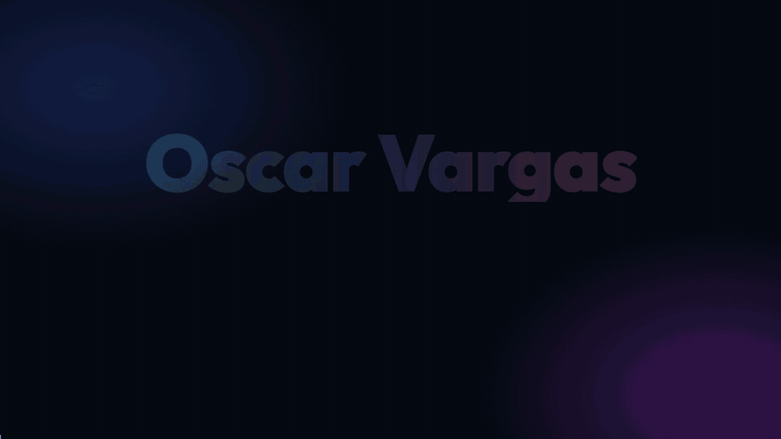

<h3>Full Stack Engineer · Fintech &amp; Digital Banking · Chile 🇨🇱 Colombia 🇨🇴 USA 🇺🇸</h3>

 ▶ Showreel — click to watch the HD version

---

## 👋 About me

Senior Full Stack Software Engineer with **7+ years** building production web platforms with **React, Next.js, TypeScript, Node.js and NestJS**. I work in **fintech, digital banking and e-commerce**, designing **microfrontends and microservices**, leading technical decisions in Scrum/Kanban teams, and shipping **8+ digital banking products** that met their delivery goals.

I also work **AI-native**: Claude Code, GitHub Copilot, Gemini, OpenCode, skills and MCPs to speed up architecture analysis, implementation, testing, migrations and documentation.

- 🔭 Currently building **[Social Publisher](https://social-publisher.vercel.app)** and shipping banking products at **Banco Falabella Chile** (consumer-credit origination).
- 🌱 Leveling up: English, design systems, data structures and cloud (AWS / Azure).
- 👯 Open to **remote** Full Stack / Backend / Cloud roles and MERN collaborations.
- 💬 Ask me about: microfrontends, NestJS, SAML/OIDC, payments, AI-assisted dev, LeetCode and ♟️ chess.

## 🧭 Career

| Year | Where | What I did |
|:--|:--|:--|
| **2025 →** | **Banco Falabella** (Chile) | Modernization and migration of the consumer-credit origination flow: microservices + microfrontends for credit evaluation, customer onboarding and loan origination; AI-driven dev workflows. |
| **2023 – 2026** | **Banco Caja Social** (Colombia) | End-to-end digital products: **CDT Digital, Bre-B, FIC, KYC Digital**; reusable UI library; microfrontend standards. |
| **2022 – 2023** | **Ionix Zeleri** | Back office and merchant portal for a multi-merchant payment-links startup (Transbank). |
| **2022 – 2023** | **Universidad Distrital** | Student events app with notifications and biometric identification (Angular, Ionic, WSO2, AWS SQS, RabbitMQ). |
| **2021 – 2022** | **Woombat Consulting** | Built **SoyYo**, an **Identity Provider (SAML + OpenID Connect) for banks**, from scratch on AWS (Lambda, RDS, EC2, SAM, Kafka), and delivered solutions for **Banco Davivienda**. |
| **2019 – 2021** | **Ingeal · Solumobil** | 177 modules in PHP/JS, e-commerce, technical-service ERP and billing, launched solo. |

## 🛠️ Stack

   
   
  

**Architecture:** Microfrontends · Microservices · Clean/Hexagonal · SOLID · SAML / OIDC / OAuth2 · Event-driven (Kafka, SQS, RabbitMQ)
**AI workflow:** Claude Code · GitHub Copilot · Gemini · OpenCode · MCP servers · custom agent skills

## 🚀 Projects

| Project | What it is |
|:--|:--|
| **[Social Publisher](https://social-publisher.vercel.app)** | Multi-network publishing platform with AI and OAuth2. |
| **[PagoVoz](https://github.com/OscarJVD/pagovoz-updates)** | Voice alerts for Bre-B / Nequi payments, with signed auto-updates. |
| **[Golpe Limpio](https://golpelimpio.vercel.app)** | Official site for a creators' boxing event in Bogotá. |
| **[Solumovil](https://solumovil.vercel.app)** | Tech store in Bogotá: Astro 6, Tailwind 4, GSAP. |
| **AI Content Repurposer** (in development) | Long video → vertical 9:16 clips with AI (transcription + highlight detection). |
| **[github-metrics-service](https://github.com/OscarJVD/github-metrics-service)** | NestJS + hexagonal architecture API for GitHub profile metrics. |
| **[kafka-nestjs-microservices-confluent](https://github.com/OscarJVD/kafka-nestjs-microservices-confluent)** | NestJS microservices talking through Kafka Confluent. |
| **[nextjs-modern-template](https://github.com/OscarJVD/nextjs-modern-template)** | Next.js template for large enterprise projects. |

## 📊 GitHub

  
  

  

## 🎓 Education

- **Software Engineering** — Politécnico Grancolombiano (graduated)
- **Analysis and Development of Information Systems** — SENA (technologist)

Thanks for stopping by ✨

